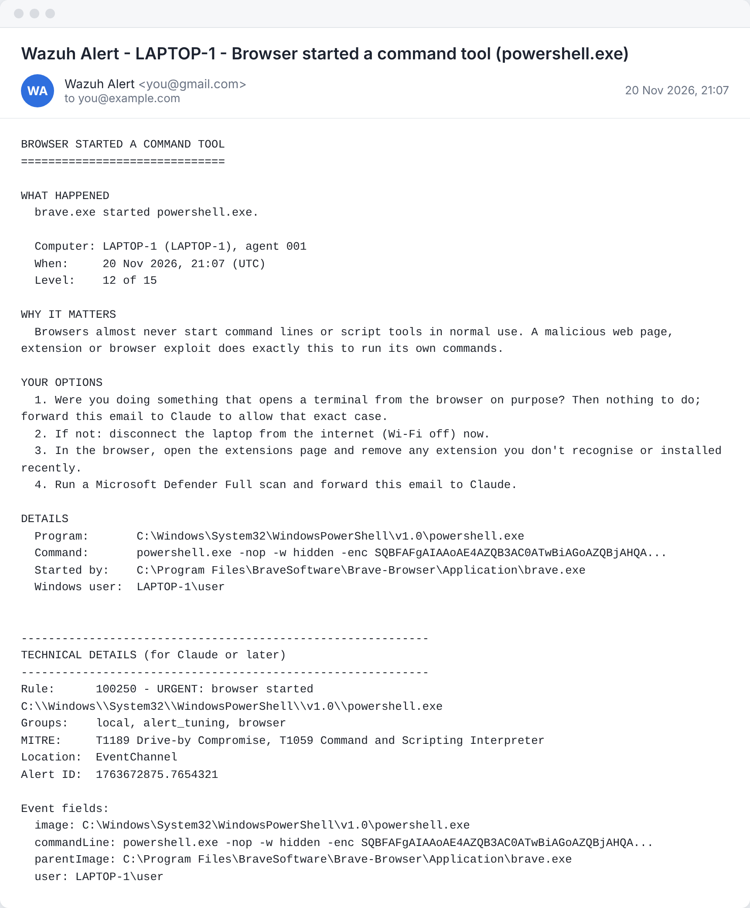

# Browser watch

The browser is where most of my risk is, so I watch three things: the browser starting a shell, extensions
being added, and native messaging hosts (how an extension starts programs outside the browser).
Rule 100250 needs Sysmon ([04](04-windows-logging.md)); 100251 and 100252 work on any Windows agent.

| What | Rule | Level | Email |
|---|---|---|---|
| A browser (Brave, Chrome, Edge, Firefox, Opera, Vivaldi) starts cmd, PowerShell, mshta, rundll32, certutil or another script tool | 100250 | 12 | yes, "Browser started a command tool" |
| An extension is installed, updated or removed (a `manifest.json` under `User Data\<profile>\Extensions\<id>\<version>\`) | 100251 | 7 | no, dashboard (search `rule.id: 100251`) |
| A native messaging host is added or changed in the registry | 100252 | 12 | yes, "New browser helper program registered" |

Rules: [server/noise_tuning.xml](../server/noise_tuning.xml). Email text: [server/custom-email-alert](../server/custom-email-alert).

## Browser starts a command tool (100250)

Sysmon event 1 where the parent is a browser and the child is a shell or script tool. Over 90 days of
real use no browser started one, so any email is worth a look.

Gotcha: the first matching child of Wazuh rule 61603 (Sysmon process created) wins. Wazuh's own rule 92052
(level 4) took the first test event, so 100250 lists 100110 and every built-in process-creation rule below
level 12 as parents. Any new custom Sysmon event 1 detection needs the same list.

Test (normal PowerShell on the laptop): a copy of PowerShell named `brave.exe` starts cmd.

```powershell
$d="$HOME\Documents\brave-test"; New-Item -ItemType Directory -Force $d | Out-Null
Copy-Item C:\Windows\System32\WindowsPowerShell\v1.0\powershell.exe "$d\brave.exe"
& "$d\brave.exe" -NoProfile -Command "cmd /c echo browser-test"
Start-Sleep 5; Remove-Item -Recurse -Force $d
```

The email looks like this (made-up example):



## Extensions and native messaging hosts (100251, 100252)

A native messaging host is a registry key naming a program that a browser extension may start. Password
managers and Office add-ins use it; a malicious extension uses it to run code outside the browser.

The agent watches (block [server/agent.conf.d/browser-watch.xml](../server/agent.conf.d/browser-watch.xml),
appended to `/var/ossec/etc/shared/default/agent.conf`):

- `C:\Users\*\AppData\Local\<browser>\User Data\*\Extensions`, only `manifest.json`, two folders deep, in real time.
- `NativeMessagingHosts` keys of Chrome, Edge, Brave and Firefox under `HKLM` (64- and 32-bit) and under
  `HKEY_USERS\<USER_SID>` (the agent runs as SYSTEM, so it can't see `HKCU`). Find the SID with
  `(Get-LocalUser $env:USERNAME).SID.Value` and put it, and the agent name, in the XML block. Registry is checked on the
  syscheck schedule (every 12 hours), not instantly.

Gotcha: the agent rebuilds its file and registry database at every start, and the first scan after a start only
records what's there, with no alerts. So never restart the agent while testing a registry change; force a scan
through the API instead (below). `agent_control -r` does not run a registry scan.

Before relying on it, list what is already there so you know your normal set (common legitimate hosts: password
managers such as KeePassXC, `com.microsoft.browsercore`, the Defender and Google Drive helpers, Adobe Acrobat):

```powershell
Get-ChildItem 'HKCU:\Software\Google\Chrome\NativeMessagingHosts','HKLM:\SOFTWARE\Google\Chrome\NativeMessagingHosts' -ErrorAction SilentlyContinue | Select-Object PSChildName
```

### Install (server)

Copy from the PC (PowerShell, repo folder):

```powershell
scp -i $HOME\.ssh\wazuh server\agent.conf.d\browser-watch.xml server\noise_tuning.xml server\custom-email-alert admin@10.10.0.1:/tmp/
```

On the server:

```bash
sudo sed -i 's/\r$//' /tmp/browser-watch.xml /tmp/noise_tuning.xml /tmp/custom-email-alert
sudo cp /var/ossec/etc/shared/default/agent.conf /var/ossec/etc/shared/default/agent.conf.bak-$(date +%F)
sudo sh -c 'cat /tmp/browser-watch.xml >> /var/ossec/etc/shared/default/agent.conf'
sudo /var/ossec/bin/verify-agent-conf
sudo install -o wazuh -g wazuh -m 660 /tmp/noise_tuning.xml /var/ossec/etc/rules/noise_tuning.xml
sudo install -o root -g wazuh -m 750 /tmp/custom-email-alert /var/ossec/integrations/custom-email-alert
sudo /var/ossec/bin/wazuh-analysisd -t && sudo systemctl restart wazuh-manager
```

Then on the laptop (PowerShell as Administrator): `Restart-Service WazuhSvc`.

### Test the native host email

Expect the email "New browser helper program registered" about a minute after the scan.
The agent must have been running for a few minutes; do not restart it during the test.

Laptop (normal PowerShell): add a fake host.

```powershell
New-Item "HKCU:\Software\Google\Chrome\NativeMessagingHosts\com.wazuh.test" -Value "C:\nothing\test.json" -Force
```

Server: start a scan of the agent (here 001) through the Wazuh API (reads the dashboard's API login from its config file):

```bash
PW=$(sudo grep -m1 'password:' /usr/share/wazuh-dashboard/data/wazuh/config/wazuh.yml | sed -E "s/.*password: *['\"]?([^'\"]*)['\"]?.*/\1/")
TOKEN=$(curl -sk -u "wazuh-wui:$PW" -X POST "https://localhost:55000/security/user/authenticate?raw=true"); unset PW
curl -sk -X PUT -H "Authorization: Bearer $TOKEN" "https://localhost:55000/syscheck?agents_list=001"; echo
```

Then remove the fake host on the laptop (the removal is detected at the next scan, no email):

```powershell
Remove-Item "HKCU:\Software\Google\Chrome\NativeMessagingHosts\com.wazuh.test*"
```

## Tried and dropped: extension allow-list

A browser policy allowing only approved extensions (ExtensionInstallBlocklist `*` + ExtensionInstallAllowlist)
works, but it also blocks extensions loaded from a folder, and approving each new one was too much friction
at home. Detection above is the lighter option: new extensions show in the dashboard (100251), new native
helpers send an email (100252).
